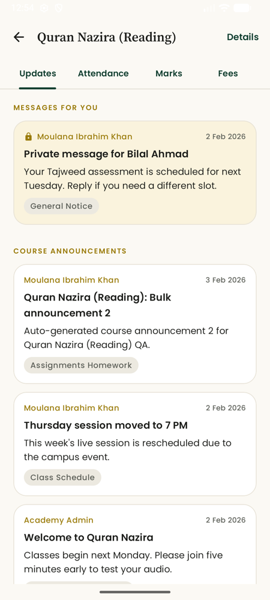

# Darse Quran Academy — Android

The native Android app for [Darse Quran Academy](https://darsequranacademy.com). Students and visitors can browse
courses, apply and pay fees, follow their classes (updates, attendance, marks, fees), read the blog, fatwas and
library, order books, and manage their account. It talks to the website's `/api/v1` API.

The design is written up in [docs/DESIGN.md](docs/DESIGN.md); bundled fonts and their licences are in
[docs/FONTS.md](docs/FONTS.md).

| Home | Course updates | Pay a fee | Home (dark) |
| :---: | :---: | :---: | :---: |
|  |  |  |  |

## What is in the app

- **Home** — greeting, verse or hadith of the day, cards for anything that needs attention (complete your profile,
  verify your e-mail, a fee that is due, a payment under review), my courses, announcements, featured courses,
  blog, fatwas and books.
- **Courses** — my courses and the catalogue (search, paging); course page with fees and teacher; apply; the
  course's Updates, Attendance, Marks and Fees tabs.
- **Pay** — enrollment and monthly fees in three steps: amount (with fee-waiver coupons and month), pay (opens a
  UPI app with the amount filled in, or shows UPI and bank details to copy), confirm (UTR and optional screenshot).
- **Explore** — fatwa (categories, search, ask a question), blog (likes and comments), library, bookstore
  (cart, checkout, orders), announcements, teachers.
- **Account** — notifications, payments and receipts (PDF), fee-waiver requests, reviews, book orders, edit
  profile and photo, change password, light/dark/system appearance, contact, about, delete account.
- Sign in with e-mail and password or Google; register; forgot password; resend the verification e-mail.

## Stack

| | |
| :--- | :--- |
| Language | Kotlin 2.4 (AGP 9 built-in Kotlin) |
| UI | Jetpack Compose, Material 3, one activity, Navigation Compose with type-safe routes |
| State | ViewModel + StateFlow, manual dependency injection (`AppContainer`) |
| Network | Retrofit 3, OkHttp 5, kotlinx.serialization; access token refreshed by an OkHttp `Authenticator` |
| Storage | DataStore (session and theme) |
| Images | Coil 3 |
| Sign-in | Credential Manager (Google ID token) |
| SDK | min 26, target and compile 37 |

```
app/src/main/java/com/darsequran/academy/
├── AcademyApp.kt, AppContainer.kt, MainActivity.kt
├── data/            Network, SessionStore, ApiCall, remote/ (API + models), repo/ (auth, academy, cart)
└── ui/
    ├── theme/       colours, type, shapes (light and dark)
    ├── common/      shared components, formatting, paging, file helpers
    ├── nav/         routes and the app's navigation graph
    └── home/ courses/ pay/ explore/ bookstore/ account/ auth/
```

## Branches

Work goes to `dev`. When CI passes for a push to `dev`, the "Sync master" workflow moves `master` to the same
commit, so the two stay in sync and `master` only ever has tested commits. Don't push to `master` directly.

## Building

You need Android Studio (or its bundled JDK) and the Android SDK.

```bash
./gradlew :app:assembleStagingDebug
```

Optional settings go in `local.properties` (not committed):

```properties
# The Web client ID from Google Cloud (OAuth). Without it the "Continue with Google" button is hidden.
GOOGLE_WEB_CLIENT_ID=1234567890-abc.apps.googleusercontent.com
# The staging website the staging flavor talks to (default: the current Vercel staging deployment).
STAGING_BASE_URL=https://staging.example.com
```

### Which server a build talks to

The server is fixed when the app is built, by its **flavor**; nothing inside the app can change it. Two flavors times
two build types make four apps, which can all be installed side by side:

| Variant | Server | Signed with | App name (`applicationId`) | Used for |
|---|---|---|---|---|
| `stagingDebug` | staging | debug key | DQA Staging (debug) (`com.darsequran.academy.staging.debug`) | everyday development |
| `productionDebug` | production | debug key | DQA (debug) (`com.darsequran.academy.debug`) | rare debugging against live data |
| `stagingRelease` | staging | debug key | DQA Staging (`com.darsequran.academy.staging`) | trying the shrunk (R8) release app |
| `productionRelease` | production | upload key | Darse Quran Academy (`com.darsequran.academy`) | the Play Store |

Test with the **staging** apps: never test against production. Staging builds show an orange STAGING strip at the
top. There is no local-server setup.

Staging's demo seed (`ALLOW_DEMO_SEED` on the website) gives you students, courses, payments and content to try the
app with. To try paying, set a UPI ID in the website's admin payment settings; for checkout, books need stock.

### Release builds

Release builds are signed with the upload key, which is never committed. Put its details in `local.properties` (or
the environment, for CI):

```properties
RELEASE_STORE_FILE=/absolute/path/to/upload.jks   # or a path relative to the project
RELEASE_STORE_PASSWORD=...
RELEASE_KEY_ALIAS=upload
RELEASE_KEY_PASSWORD=...
```

Without them `./gradlew :app:assembleProductionRelease` stops with a message instead of signing with the debug key.
Give each published build a higher version code: `./gradlew :app:bundleProductionRelease -PversionCode=3`.
`./gradlew :app:assembleStagingRelease` builds the same shrunk app on staging, signed with the debug key, to try it
without the upload key.
Create the key once with Android Studio (**Build → Generate Signed App Bundle / APK → Create new**) or `keytool`,
and keep it and its passwords somewhere safe: Play Store updates must be signed with the same key.
