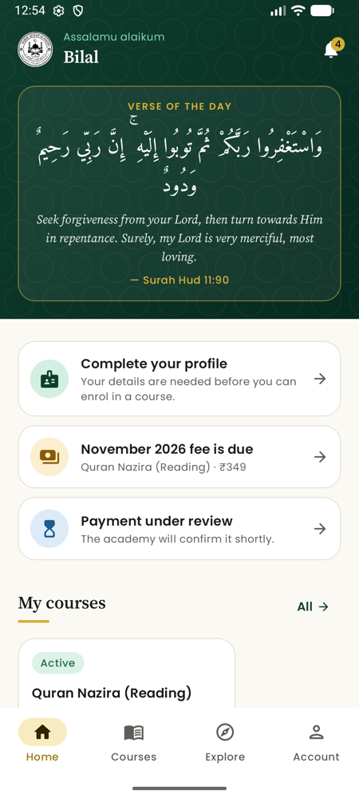
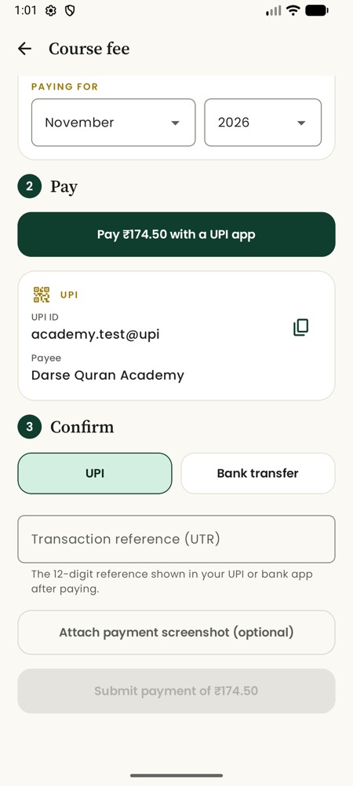
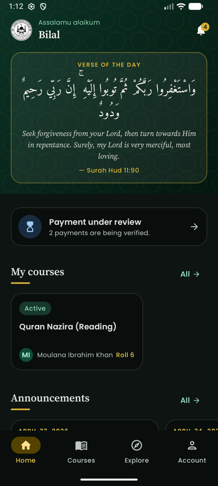

# Darse Quran Academy — Android

The native Android app for [Darse Quran Academy](https://darsequranacademy.com). Students and visitors can browse
courses, apply and pay fees, follow their classes (updates, attendance, marks, fees), read the blog, fatwas and
library, order books, and manage their account. It talks to the website's `/api/v1` API.

The design is written up in [docs/DESIGN.md](docs/DESIGN.md); bundled fonts and their licences are in
[docs/FONTS.md](docs/FONTS.md).

| Home | Course updates | Pay a fee | Home (dark) |
| :---: | :---: | :---: | :---: |
|  |  |  |  |

## What is in the app

- **Home** — greeting, verse or hadith of the day, cards for anything that needs attention (complete your profile,
  verify your e-mail, a fee that is due, a payment under review), my courses, announcements, featured courses,
  blog, fatwas and books.
- **Courses** — my courses and the catalogue (search, paging); course page with fees and teacher; apply; the
  course's Updates, Attendance, Marks and Fees tabs.
- **Pay** — enrollment and monthly fees in three steps: amount (with fee-waiver coupons and month), pay (opens a
  UPI app with the amount filled in, or shows UPI and bank details to copy), confirm (UTR and optional screenshot).
- **Explore** — fatwa (categories, search, ask a question), blog (likes and comments), library, bookstore
  (cart, checkout, orders), announcements, teachers.
- **Account** — notifications, payments and receipts (PDF), fee-waiver requests, reviews, book orders, edit
  profile and photo, change password, light/dark/system appearance, contact, about, delete account.
- Sign in with e-mail and password or Google; register; forgot password; resend the verification e-mail.

## Stack

| | |
| :--- | :--- |
| Language | Kotlin 2.4 (AGP 9 built-in Kotlin) |
| UI | Jetpack Compose, Material 3, one activity, Navigation Compose with type-safe routes |
| State | ViewModel + StateFlow, manual dependency injection (`AppContainer`) |
| Network | Retrofit 3, OkHttp 5, kotlinx.serialization; access token refreshed by an OkHttp `Authenticator` |
| Storage | DataStore (session and theme) |
| Images | Coil 3 |
| Sign-in | Credential Manager (Google ID token) |
| SDK | min 26, target and compile 37 |

```
app/src/main/java/com/darsequran/academy/
├── AcademyApp.kt, AppContainer.kt, MainActivity.kt
├── data/            Network, SessionStore, ApiCall, remote/ (API + models), repo/ (auth, academy, cart)
└── ui/
    ├── theme/       colours, type, shapes (light and dark)
    ├── common/      shared components, formatting, paging, file helpers
    ├── nav/         routes and the app's navigation graph
    └── home/ courses/ pay/ explore/ bookstore/ account/ auth/
```

## Building

You need Android Studio (or its bundled JDK) and the Android SDK.

```bash
./gradlew :app:assembleDebug
```

Optional settings go in `local.properties` (not committed):

```properties
# The Web client ID from Google Cloud (OAuth). Without it the "Continue with Google" button is hidden.
GOOGLE_WEB_CLIENT_ID=1234567890-abc.apps.googleusercontent.com
# Where the debug build finds the website. Default: http://10.0.2.2:3000 (the emulator's alias for your computer).
DEBUG_BASE_URL=http://localhost:3000
```

Release builds always use `https://darsequranacademy.com`. Debug builds install next to the release app as
"DQA (debug)" (`com.darsequran.academy.debug`).

### Running against a local copy of the website

1. Start the website on your computer: `npx next dev --hostname 0.0.0.0 --port 3000`.
2. If the emulator can't reach `10.0.2.2:3000` (a firewall can block it), forward the port instead and set
   `DEBUG_BASE_URL=http://localhost:3000`:

   ```bash
   adb reverse tcp:3000 tcp:3000
   ```

   Re-run it after reinstalling the app or restarting the emulator; the forward does not always survive.
3. `./gradlew :app:installDebug`.

The website's demo seed (`ALLOW_DEMO_SEED`) gives you students, courses, payments and content to try the app with.
To try paying, set a UPI ID in the website's admin payment settings; for checkout, books need stock.
